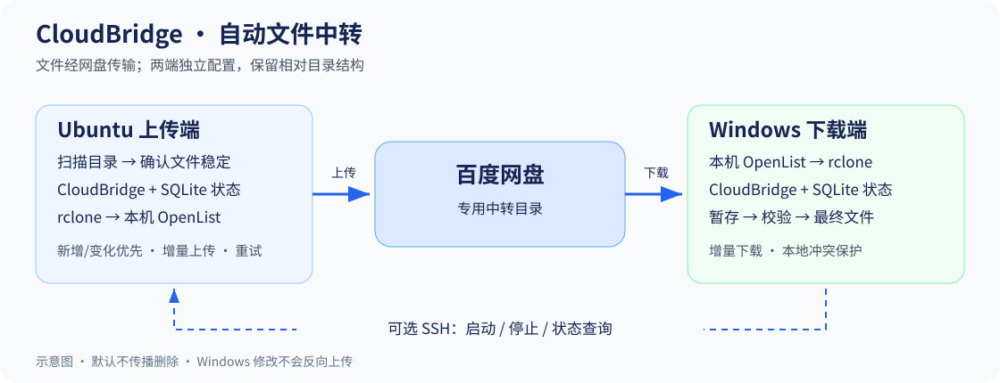
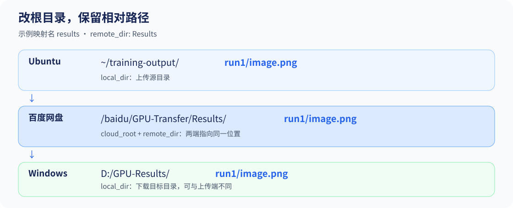

# CloudBridge 图文使用指南

目标：Ubuntu 生成文件 → 百度网盘中转 → Windows 自动下载。图示为流程和配置示意，不是 OpenList 界面截图；具体授权页面以安装版本为准。



## 1. 准备两台机器

| 项目 | Ubuntu 上传端 | Windows 下载端 |
| --- | --- | --- |
| 系统 | Ubuntu 22.04 / 24.04 为主要目标 | Windows 10 / 11 |
| Python | 3.11+，含 venv | 3.11+，含 py 启动器 |
| 终端 | Bash | PowerShell 5.1+ |
| 传输组件 | rclone、已配置的 OpenList | rclone、已配置的 OpenList |
| CloudBridge | 同一版本源码 | 同一版本源码 |
| SSH | 独立上传不需要 | 仅一键管理 Ubuntu 时需要已有 SSH 登录 |

从 [仓库](https://github.com/Rimkel/cloudbridge_sync) 下载源码或克隆：

```bash
git clone https://github.com/Rimkel/cloudbridge_sync.git cloudbridge
cd cloudbridge
```

Windows 也可使用 Git，或将 ZIP 解压到例如 `D:\CloudBridge`。**根目录应直接包含 pyproject.toml、scripts 和 start-sync.cmd**；不要在 OpenList 或内层 cloudbridge Python 包目录中执行安装命令。后文命令均从仓库根目录执行。

OpenList 与 rclone 需单独安装，CloudBridge 安装脚本不会下载安装这两个程序，也不会替你授权百度账号。参考 [OpenList 文档](https://doc.oplist.org/) 与 [rclone 安装说明](https://rclone.org/install/)。

## 2. 配置 OpenList 和百度网盘

两台机器分别完成：

1. 在固定目录启动 OpenList，打开本机管理页面，例如 `http://127.0.0.1:5244`。
2. 按 [百度网盘驱动官方文档](https://doc.oplist.org/guide/drivers/baidu) 完成所选方式的授权并添加存储。凭据只填入自己管理的 OpenList，不写入 CloudBridge YAML。
3. 将挂载目录设为例如 `/baidu`。确认存储状态正常，并在文件页面进入该目录看到真实文件。
4. 在这个挂载下创建 `GPU-Transfer/Results`；两端必须能看到同一云端目录。
5. 配置 rclone 使用的 OpenList 用户。上传端需要 WebDAV 读取、WebDAV 管理及创建目录/上传权限；下载端需要读取权限。见 [官方权限说明](https://doc.oplist.org/guide/advanced/webdav)。


**记住原有数据目录。** 工作目录变化可能让 OpenList 使用另一份空数据。已有实例应固定原 data 和配置文件路径；启动后存储“消失”时先核对目录，不要先重新初始化。详见 [OpenList 配置](docs/openlist.md)。

两端授权分别维护。遇到 `expired_token` 等错误，在对应实例按所用授权方式修复，不反复粘贴失效的旧 token。大文件下载可能需要 OpenList 代理模式或特定请求头，按上述百度驱动文档配置并实测。

## 3. 配置 rclone

在两端分别运行：

```text
rclone config
```

按字段选择，不依赖菜单编号：

| 字段 | 示例值 / 含义 |
| --- | --- |
| 新 remote 的名称 | baidu |
| 类型 | webdav |
| URL | http://127.0.0.1:5244/dav/，按自己的实例调整 |
| vendor | 普通 WebDAV 服务可用 other |
| user / pass | OpenList 用户及密码，不是百度 refresh token |

完整选项见 [rclone WebDAV 文档](https://rclone.org/webdav/)。如果 OpenList 用户的根目录受限制，rclone 看到的路径也可能不同，以实际列目录结果为准。

```bash
rclone version
rclone listremotes
rclone lsd baidu:/baidu/GPU-Transfer
```

预期 remote 列表含 `baidu:`，目录列表可看到 Results。`baidu:` 是 rclone 配置名，后面的 `/baidu` 是 OpenList 挂载路径，两者含义不同。私有配置由两端各自的 rclone 管理，不能只在 Ubuntu 配置一次。

## 4. 安装 CloudBridge 并添加目录

下面本地路径仅为示例，替换为自己的目录；远端相对目录两端一致。



### Ubuntu

```bash
bash scripts/install_ubuntu.sh
source .venv/bin/activate
cloudbridge --config configs/ubuntu.yaml mapping add \
  --name results --local "$HOME/training-output" --remote Results
cloudbridge --config configs/ubuntu.yaml mapping list
cloudbridge --config configs/ubuntu.yaml config validate
```

源目录必须已存在。安装脚本生成空映射配置，mapping add 会添加并启用这一组；不提供参数时可以交互填写。不要重复添加同名映射。

### Windows

```powershell
.\scripts\install_windows.ps1
.\.venv\Scripts\cloudbridge.exe --config configs/windows.yaml mapping add `
  --name results --local 'D:/GPU-Results' --remote Results
.\.venv\Scripts\cloudbridge.exe --config configs/windows.yaml mapping list
.\.venv\Scripts\cloudbridge.exe --config configs/windows.yaml config validate
```

目标目录不存在时会创建。如果仅本次调用被执行策略阻止，可从仓库根目录运行：

```powershell
powershell.exe -NoProfile -ExecutionPolicy Bypass -File .\scripts\install_windows.ps1
```

此选项只作用于该进程；组织强制策略需按所在环境处理。

### 核对 YAML

两端核对下列字段。以下只是片段，**合并到已有字段，不要覆盖整份配置或重复创建 backend / sync 键**：

```yaml
backend:
  rclone_remote: baidu
  cloud_root: /baidu/GPU-Transfer
sync:
  mappings:
    - name: results
      enabled: true
      local_dir: /home/your-user/training-output  # Windows 改为 D:/GPU-Results
      remote_dir: Results
      recursive: true
```

最终云端路径为 cloud_root + remote_dir + 文件相对路径。支持多组映射；本地或远端映射不得相互重叠，remote_dir 使用相对路径，不使用 `..`。

Windows 路径推荐正斜杠；反斜杠路径用单引号。--config 始终写在子命令前。手写 YAML 的相对本地路径基于 YAML 所在目录，CLI 添加的相对路径基于执行命令的目录。

## 5. 选择文件类型

新安装默认仅同步 PNG、JPG/JPEG、WebP、TIF/TIFF。论文文件可以将**两端**现有 filters 替换为：

```yaml
filters:
  include:
    - '*.png'
    - '*.jpg'
    - '*.jpeg'
    - '*.webp'
    - '*.tif'
    - '*.tiff'
    - '*.pdf'
    - '*.svg'
    - '*.eps'
    - '*.md'
    - '*.markdown'
    - '*.tex'
    - '*.bib'
    - '*.sty'
    - '*.cls'
    - '*.bst'
    - '*.docx'
  exclude:
    - '*.tmp'
    - '*.part'
    - '*.partial'
    - '.cloudbridge-*'
    - '~$*'  # Word 临时锁定文件
    - '.env'
    - '.env.*'
    - '*.pem'
    - '*.key'
    - 'rclone.conf'
  max_file_size_mb: 0  # 不限制大小
```

后缀匹配不区分大小写。需要 TXT、JSON、CSV 时自行追加；只修改一端可能出现“上传了但下载不下来”。过滤规则不能替代目录隔离：只映射结果目录，凭据、OpenList 数据、CloudBridge 状态库和日志放在目录外。

## 6. 检查连接与首次传输

两端分别执行只读诊断：

```bash
# Ubuntu（已激活虚拟环境）
cloudbridge --config configs/ubuntu.yaml doctor
```

```powershell
# Windows
.\.venv\Scripts\cloudbridge.exe --config configs/windows.yaml doctor
```

应显示 remote、WebDAV、云端根目录和映射可读。若允许写入一份小测试文本，在 Ubuntu 显式执行：

```bash
cloudbridge --config configs/ubuntu.yaml doctor --write-test
```

此命令在云端根目录上传唯一文本并下载回 Ubuntu 校验 SHA-256，云端测试文件保留。它不等同于 Windows 完整链路验证。

在源目录加入一张独立测试 PNG，保持两端运行：

```bash
cloudbridge --config configs/ubuntu.yaml upload --daemon
```

```powershell
.\.venv\Scripts\cloudbridge.exe --config configs/windows.yaml download --daemon
```

首次扫描记录观察；后续扫描确认稳定后传输。上传还要求达到 min_file_age_seconds。打开 Windows 对应文件并比较两端哈希：

```bash
sha256sum "$HOME/training-output/probe.png"
```

```powershell
Get-FileHash -Algorithm SHA256 'D:\GPU-Results\probe.png'
```

两份 SHA-256 应一致。Ctrl+C 可安全结束前台同步。--once 只扫描一轮，不会在命令内等待第二轮确认。

## 7. 日常一键启动

先完成手动链路，再配置一键入口。Windows 应已能用现有 SSH 登录 Ubuntu，例如 `ssh gpu-server`；将示例别名替换成自己的别名或 user@host。

1. 停止之前手动启动的上传和下载；使用服务时按原方式停止 CloudBridge 服务。
2. 首次将 configs/oneclick.example.yaml 复制为 configs/oneclick.yaml；已有文件直接编辑。
3. 将 ssh_host、remote.project_dir 改为真实服务器和 Ubuntu 项目路径；填写 Windows 原有 OpenList 数据目录。Ubuntu 系统服务可用 auto 检测，容器可用 external。
4. 双击 setup-oneclick.cmd 检查，再双击 start-sync.cmd 开始传输。

```text
配置完成
   │
   ├─ start-sync.cmd ── 启动同步并打开进度
   ├─ view-progress.cmd ── 只查看进度
   └─ stop-sync.cmd ── 停止本入口启动的同步，保留 OpenList
```

关闭进度窗口后同步继续；Windows 注销、关机或 Ubuntu 重启后需重新启动。计数是状态库累计记录，不是实时字节百分比。详见 [一键配置](docs/oneclick.md)。

若希望两端独立运行，可用 [Ubuntu 用户服务](docs/ubuntu.md#systemd-用户服务) 和 [Windows 登录任务](docs/windows.md#当前用户登录任务)。选择一种方式管理同一份配置，避免重复实例；这些服务依赖 OpenList 按自己的部署方式运行。

## 8. 状态、失败恢复与速度

```bash
# Windows 改用 .\.venv\Scripts\cloudbridge.exe 和 windows.yaml
cloudbridge --config configs/ubuntu.yaml status
cloudbridge --config configs/ubuntu.yaml logs --lines 30
```

| 状态 | 意义 |
| --- | --- |
| WAITING_STABLE | 等待第二次观察或最小文件年龄 |
| PENDING / TRANSFERRING | 排队或正在传输 |
| SUCCESS | 上一次传输成功，并非本轮重新校验了全部内容 |
| FAILED / RETRY | 失败或等待重试；查看错误和尝试次数 |
| CONFLICT | 本地存在未知或修改后的版本，默认保留 |

临时失败达到次数上限时，先停止对应同步、解决原因，再执行：

```powershell
.\.venv\Scripts\cloudbridge.exe --config configs/windows.yaml retry-failed --mapping results
```

随后正常启动。此命令只重新排队临时失败，不会重传成功文件；永久失败和冲突仍需人工处理。不要用全目录 --force 代替失败恢复。

| sync 字段 | 作用 |
| --- | --- |
| interval_seconds | 一轮完成后的等待时间，可从默认 120 调到 30 观察负载 |
| min_file_age_seconds | 上传文件距最后修改的最小年龄，建议保留 120 |
| max_concurrent_transfers | 同时传输文件数，全部映射共享，允许 1–32 |
| retry_attempts | 包括首次尝试的最大次数 |

实际等待包含扫描耗时、稳定观察、网盘延迟和 **OpenList 目录缓存**。缓存需要在 OpenList 存储设置中调整，单位按界面显示；CloudBridge 不会自动修改。增加并发可能触发限流，应根据实际错误率调整。

普通过滤与调度参数在轮间安全加载。方向、remote、云端根目录、状态库变更需要重启及适当的独立状态库。代码更新也需要重启；不要在运行中覆盖源码。

## 9. 更新与排错

升级前停止两端同步，备份各端 YAML、SQLite 和私有授权数据，再使用相同版本源码更新两端、重新执行安装脚本安装依赖。已有配置不会被安装脚本覆盖，随后重新运行 doctor 和小文件校验。

维护者可执行 `python scripts/build_windows_update.py` 生成源码更新包。它不含 .venv、用户 YAML、OpenList 二进制/数据和凭据，仍需要 Python 与依赖，不是免安装程序。

| 现象 | 先检查 |
| --- | --- |
| 找不到安装脚本 | 是否进入含 pyproject.toml 的仓库根目录 |
| remote 不存在 | 是否在运行同步的同一个系统用户下配置 rclone |
| HTTP 401 / 403 | OpenList 登录、百度授权和 WebDAV 权限 |
| OpenList 重启后空白 | 是否换了原数据目录或启动了第二个实例 |
| 新文件迟迟没到 | 两端后台、过滤规则、稳定观察、目录缓存和日志 |
| 已有实例占用 | 是否同时运行一键入口与前台/系统服务 |
| 文件冲突 | 先保留并比对本地修改，默认不静默覆盖 |
| 同名同大小更新漏检 | WebDAV 版本信息限制，优先使用新结果文件名 |

完整说明见 [故障排查](docs/troubleshooting.md)。反馈时移除账号、token、带签名 URL 和个人路径。
